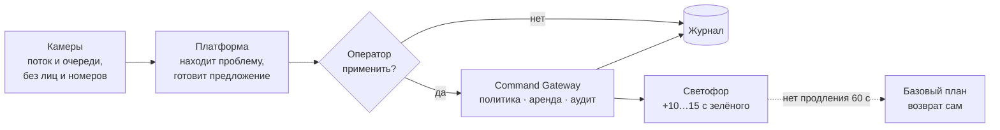
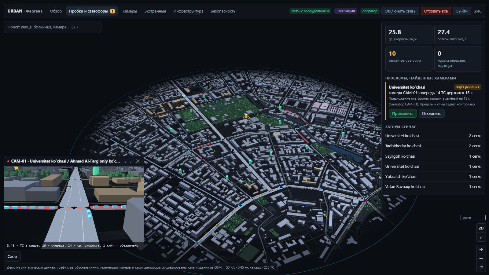

<div align="center">

# URBAN

**Центр управления городом, который защищает город, а не следит за жителями**

Камеры находят проблему · платформа предлагает решение · оператор решает · при сбое всё возвращается на место


</div>

## Что это

Демо-макет платформы **URBAN** (команда NEXUS) на цифровом двойнике центра Ферганы.
Работает локально на Windows, без Docker и без внешних сервисов.

Идея выросла из образа «городской операционной системы», но с обратным принципом:
**Protect the city, don't control its residents.** Камеры считают поток и очереди, а не людей;
платформа ничего не делает сама; любое вмешательство истекает само.

> **Важно:** оборудование в демо эмулируется. Реальные светофоры Ферганы не затрагиваются:
> они работают автономно, и для настоящего управления нужны модули связи на перекрёстках.

## Как это работает



1. **Камера видит очередь.** Шесть и более стоящих машин на подъезде дольше 15 секунд.
2. **Платформа предлагает** продлить зелёный этому подъезду. Сама она ничего не применяет.
3. **Оператор решает.** Кнопки доступны только после входа по токену.
4. **Светофор помогает.** Команда живёт как аренда и продлевается, пока есть связь.
5. **Сбой ничего не ломает.** Пропала связь или платформа — контроллер сам возвращает свой план.

| Камера нашла проблему | Журнал и правила безопасности |
|---|---|
|  |  |

## Почему это безопаснее

| Правило | Как сделано |
|---|---|
| Решает человек | платформа только предлагает; без токена оператора интерфейс в режиме просмотра |
| Один путь к оборудованию | Command Gateway с белым списком команд: сейчас разрешена одна |
| Команда истекает сама | аренда 60 с, продление пока есть связь, окно подтверждения 5 минут |
| Откат на стороне оборудования | контроллер возвращает базовый план без участия платформы |
| Жёсткие пределы | не больше +15 с к фазе, одна команда на перекрёсток; проверяет и сам контроллер |
| Аварийные кнопки | «Отозвать всё» и «Отключить связь» (показывает автооткат вживую) |
| Всё записано | журнал аудита с цепочкой SHA-256, проверка целостности в `/api/audit` |
| Приватность | с камер уходят только счётчики; лица, номера и треки не обрабатываются |

Модель угроз и ступени допуска к управлению: [docs/security.md](docs/security.md).

## Помогает ли это на самом деле

Мы это измерили, а не предположили. Один и тот же трафик прогоняется дважды: без вмешательства и с
применением всех предложений платформы.

**Результат честный и пока отрицательный: измеримого эффекта нет.** За 6 пар прогонов по 30 минут
симуляции средние потери времени на машину изменились на −0,4 с из 304,5 с (−0,1 %) при стандартной
ошибке 5,2 с. В трёх прогонах стало лучше, в трёх хуже.

| Показатель | Без вмешательства | С управлением | В пользу управления |
|---|---|---|---|
| Потери времени на машину | 304,5 с | −0,4 с (−0,1 %) ± 5,2 | 3 из 6 прогонов |
| Завершено поездок | 1846 | +3,8 (+0,2 %) ± 28 | 3 из 6 прогонов |

Что это значит: цикл «камера → предложение → оператор → светофор → автооткат» работает и безопасен,
но само правило «продлить зелёный на подъезде с очередью» в перегруженной сети только перекладывает
задержку с одного направления на другое. Следующий шаг — правила умнее: координация соседних
перекрёстков и учёт встречных очередей. Инструмент для проверки каждого нового правила уже есть.

Полная таблица и ограничения замера: [docs/benchmark.md](docs/benchmark.md).

## Быстрый старт

Нужны Python 3.11+ и Node.js 20+.

```powershell
scripts\setup.ps1     # один раз: окружение, зависимости, сборка интерфейса, подготовка данных
scripts\run.ps1       # запуск: http://localhost:8080, токен оператора печатается в консоли
```

<details>
<summary>То же самое вручную</summary>

```bash
python -m venv .venv
.venv/Scripts/python -m pip install -e "backend[dev]"
cd web && npm install && npm run build && cd ..
cp .env.example .env
.venv/Scripts/python -m urban.pipeline     # OSM -> сеть SUMO, спрос, слои карты
.venv/Scripts/python -m urban              # сервер
```

Тесты: `.venv/Scripts/python -m pytest backend`.
Замер эффекта: `.venv/Scripts/python -m urban.experiments.green_extension`.
Пересобрать только слои карты: `python -m urban.pipeline --geo`.
Перед запуском пайплайна остановите сервер: он держит файлы в `data/`.

</details>

## Что есть в интерфейсе

| Модуль | Что показывает |
|---|---|
| **Обзор** | показатели района, проблемы, ждущие решения, лента анализа |
| **Пробки и светофоры** | проблемы, найденные камерами; «Применить» и «Отклонить»; очередь до и после; отсчёт до возврата |
| **Камеры** | 8 виртуальных камер на регулируемых перекрёстках: вид с точки камеры, поток, очередь |
| **Экстренные** | ДТП, выезд скорой и ДПС от реальных больниц и полиции, расчётное и фактическое время |
| **Инфраструктура** | 12 объектов (подстанции, насосные, теплопункты): отклонения и прогноз достижения порога |
| **Безопасность** | состояние связи, действующие правила, журнал аудита |

<details>
<summary>Управление картой</summary>

| Действие | Как |
|---|---|
| Перемещение | перетаскивание левой кнопкой, стрелки |
| Масштаб | колесо мыши (к курсору), двойной щелчок, кнопки и клавиши + и − |
| Поворот и наклон | правая кнопка или Ctrl + левая кнопка |
| Север вверх | щелчок по компасу |
| 2D / 3D, весь район | кнопки над масштабом |
| Поиск | поле слева вверху или клавиша `/`: улицы, больницы, полиция, камеры, объекты |
| Карточка объекта | щелчок по зданию, улице, остановке, объекту; Esc закрывает |
| Камеры | щелчок по камере; в окне перетаскивание меняет взгляд, стрелки переключают камеры |
| Слои | кнопка «Слои» слева внизу |
| Ссылка на вид | положение карты хранится в адресе страницы |

</details>

## Что настоящее, а что смоделировано

| Настоящее | Смоделировано |
|---|---|
| дорожная сеть, здания, больницы, полиция (OpenStreetMap) | трафик: случайные поездки в SUMO |
| шлюз команд: политика, аренда, решение оператора | светофоры и их контроллеры |
| журнал аудита, токен оператора, блокировка перебора | камеры: вид двойника, не видеопоток |
| анализ очередей и отклонений | автобусные линии и остановки (в OSM по Фергане маршрутов нет) |
| | телеметрия объектов, высоты большинства зданий |

«ИИ» в макете — это понятные правила и статистика (устойчивая очередь, отклонение от базового уровня,
линейный тренд), а не обученные модели. Настоящая видеоаналитика должна работать на стороне камеры
и отдавать платформе только счётчики.

## Структура

```
backend/urban/
  core/          шина событий и контракты сообщений
  sources/       симуляция как источник данных, эмуляция контроллеров светофоров
  analytics/     очереди у камер, заторы, отклонения и прогноз
  gateway/       Command Gateway: политика, аренда, журнал аудита
  platform.py    ядро: анализ и предложения
  api/           HTTP/WebSocket, токен оператора
  pipeline/      подготовка данных из OSM
  experiments/   замер эффекта управления
backend/tests/   20 тестов
web/src/         интерфейс: scene/ (3D-сцена), map/ (навигация, камера, поиск), ui/ (панель)
docs/            архитектура, безопасность, замер
```

Документы: [CONTEXT.md](CONTEXT.md) (замысел, решения, состояние) ·
[docs/architecture.md](docs/architecture.md) · [docs/security.md](docs/security.md) ·
[docs/benchmark.md](docs/benchmark.md)

## Что дальше

- Правило управления умнее: учёт очередей на всех подъездах и координация соседних перекрёстков; проверка тем же замером.
- Зелёный коридор для экстренных служб как вторая разрешённая команда.
- Реальные маршруты автобусов, хранилище событий, учётные записи операторов с ролями.
- Изучить контроллеры светофоров Ферганы и требования регулятора.

## Данные и инструменты

Картографические данные © участники [OpenStreetMap](https://www.openstreetmap.org/copyright), лицензия ODbL.
Симуляция: [Eclipse SUMO](https://eclipse.dev/sumo/). Отрисовка: [deck.gl](https://deck.gl) и [MapLibre](https://maplibre.org).
