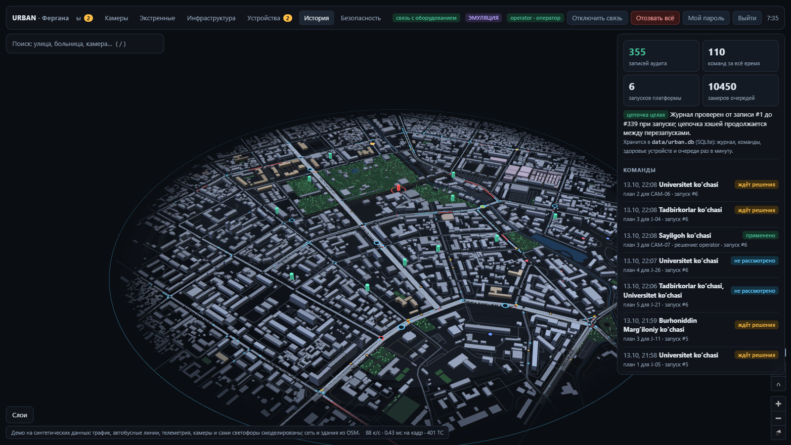
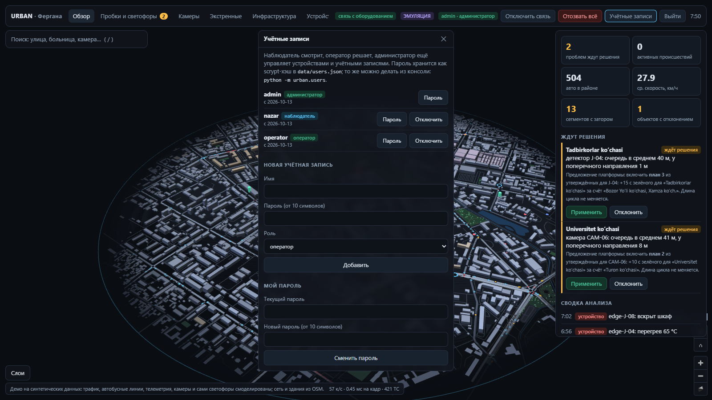
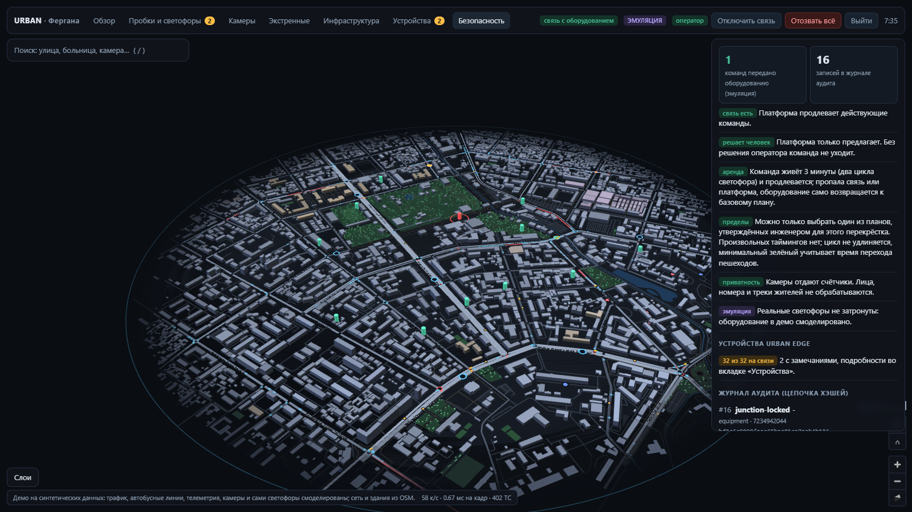
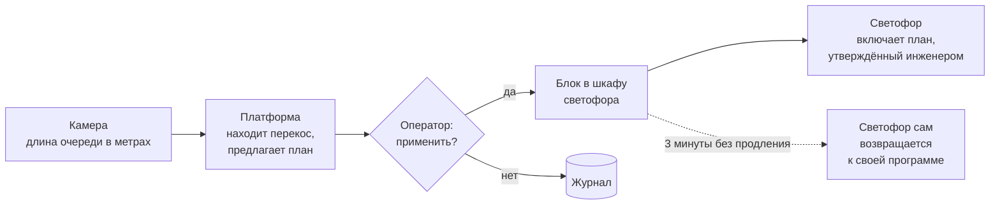

<div align="center">

# URBAN

**Городской центр управления, который помогает городу и не следит за людьми**


</div>

## О чём это

В Фергане, как и во многих городах, светофоры работают каждый сам по себе: у них есть программа, но никто не
видит, что на перекрёстке прямо сейчас стоит очередь на сотню метров, а поперечная улица пустая. URBAN — это
попытка это исправить, не превращая город в систему слежки.

Идея простая. **Камера видит очередь → платформа замечает проблему и предлагает решение → человек решает →
светофор помогает → если что-то пошло не так, всё само возвращается как было.**

Мы вдохновлялись образом ctOS из Watch Dogs, но с обратным принципом:
*Protect the city, don't control its residents.* Камеры считают метры очереди, а не людей. Лица, номера машин
и маршруты никуда не уходят и не хранятся.

Сейчас это рабочий прототип для пилота: его можно запустить у себя и посмотреть на цифровом двойнике центра
Ферганы, а код для настоящих перекрёстков и сервера уже написан. Чего пока нет — так это железа на улице.

## Как это выглядит

| Камера заметила пробку | Состояние устройств на перекрёстках |
|---|---|
|  |  |

| История всех решений | Учётные записи и роли |
|---|---|
|  |  |

| Журнал и правила безопасности | Вход |
|---|---|
|  |  |

## Как это работает



1. **Камера измеряет очередь.** Не считает машины и не узнаёт их — просто видит, где кончается хвост.
2. **Платформа замечает перекос:** с одной стороны стоят 40 метров и больше, а у поперечной улицы зелёный
   горит впустую. Она предлагает включить один из планов, которые заранее утвердил инженер для этого
   перекрёстка, например «+10 секунд зелёного этой улице за счёт той».
3. **Решает человек.** Сама платформа ничего не включает. Оператор видит, что и почему предложено, и жмёт
   «Применить» или «Отклонить».
4. **Команда живёт три минуты** и продлевается, пока всё в порядке. Очередь ушла — команда снимается сама.
5. **Любой сбой безопасен.** Пропала связь, упал сервер, вскрыли шкаф — светофор возвращается к своей
   обычной программе без чьей-либо помощи.

## Почему этому можно доверять

Больше всего мы боимся одного: что систему взломают. Поэтому она устроена так, чтобы даже полный взлом
сервера не мог навредить на улице.

- **Можно только выбрать готовый план.** Платформа не задаёт секунды и не включает лампы. Худшее, что можно
  сделать, — выбрать один из планов, которые инженер признал безопасными. Затор устроить можно, аварию нельзя.
- **Всё временно.** Любая команда сама истекает через три минуты, а откат живёт в самом светофоре, не на сервере.
- **Блок на перекрёстке никому не верит на слово.** Он проверяет подпись каждой команды, отказывает подделкам
  и повторам, а свой ключ создаёт сам — на сервер попадает только открытая половина.
- **Украденный пароль ничего не даёт.** У операторов вход по паролю и коду с телефона. Без второго фактора —
  только просмотр.
- **Журнал не переписать.** Каждое действие записывается в цепочку, где каждая запись закреплена за предыдущей,
  и копия сразу уходит за пределы сервера. Подмену видно.
- **Ключи можно сменить.** Если ключ сервера утёк, его меняют одной командой, и блоки на улице перестают ему
  верить без выезда на перекрёстки.
- **Не следим за людьми.** С камер уходят только числа.

Подробно, с моделью угроз: [docs/security.md](docs/security.md).

## Это правда помогает?

Мы проверили, а не поверили на слово. Один и тот же трафик в симуляции прогоняется дважды — без вмешательства
и с выполнением всех предложений платформы.

| Нагрузка | Время, которое машина теряет в пробках |
|---|---|
| средняя | **на 17 % меньше** (194 → 161 секунда) |
| высокая | **на 12 % меньше** (303 → 266 секунд) |
| низкая | разницы нет — и не должно быть |

Честные оговорки: трафик синтетический, а исходные программы светофоров в симуляции простые, так что на
настроенных инженером перекрёстках выигрыш будет меньше. А наше первое правило вообще не работало — замер это
показал, и мы его переделали. Подробности: [docs/benchmark.md](docs/benchmark.md).

## Что готово, а что нет

| Готово и работает | Написано, но на настоящем ещё не проверено | Нужен реальный город |
|---|---|---|
| центр управления, карта района в 3D | блок на перекрёстке и его связь с контроллером | обследовать светофоры Ферганы |
| предложения, решения оператора, автооткат | камерный модуль, который считает очередь | стенд: контроллер и камера на столе |
| учётные записи, коды с телефона | установка на сервер | сервер внутри страны |
| история и журнал, проверка подмены | | записи видео с реальных подъездов |

Система работает в двух режимах. **Настоящий** (по умолчанию): карта и перекрёстки города из OpenStreetMap,
очереди и команды — через реальные блоки URBAN Edge, симулятор не нужен вовсе. Пока паспорт перекрёстка не
утвердил инженер, перекрёсток только наблюдается. **Демо-двойник** (`--demo`) — для презентаций: трафик,
светофоры и блоки смоделированы, интерфейс так и подписан, а ключи и история хранятся отдельно от настоящих.

## Запустить у себя

Нужны Python 3.11+ и Node.js 20+. Docker не нужен, всё работает на Windows.

```powershell
scripts\setup.ps1
```

Один раз: окружение, зависимости, интерфейс, город и демо-двойник из OpenStreetMap (нужен интернет).

```powershell
scripts\run.ps1
```

Это настоящая система. Откройте http://localhost:8080. При первом запуске в консоли появится пароль учётной
записи `admin` — он показывается один раз. Войдите, смените его и заведите операторов. В разделе
«Перекрёстки» — паспорта всех светофорных перекрёстков района: сверить с контроллером и утвердить.

```powershell
scripts\demo.ps1
```

Демо-двойник для показа: через пару минут в разделе «Пробки и светофоры» появятся первые предложения.

Как пользоваться интерфейсом — [руководство пользователя](docs/guide.md). Как подключить настоящие блоки и
поставить всё на сервер — [deploy/README.md](deploy/README.md).

### В VS Code

Откройте папку проекта — служебные папки уже скрыты, и вы увидите только это:

```
backend/    платформа и программа блока на Python
web/        интерфейс в браузере
docs/       документы: руководство, безопасность, железо, замеры
deploy/     установка на сервер
scripts/    запуск на Windows
data/       карта, ключи, база — создаётся само, в git не попадает
README.md   этот файл (под ним свёрнут CONTEXT.md — замысел и решения)
```

В каждой папке свой короткий README. Запуск — кнопкой ▶ на панели «Run and Debug» («URBAN: платформа» или «URBAN: демо-двойник»)
или через «Terminal → Run Task…»: там по порядку подготовка, запуск, сборка интерфейса, тесты и замер.
VS Code сам предложит нужные расширения.

<details>
<summary>Без скриптов, вручную</summary>

```bash
python -m venv .venv
.venv/Scripts/python -m pip install -e "backend[dev]"
cd web && npm install && npm run build && cd ..
cp .env.example .env
.venv/Scripts/python -m urban.city create --name "Фергана, центр"   # город: карта и паспорта из OSM
.venv/Scripts/python -m urban              # настоящая система
.venv/Scripts/python -m urban.pipeline     # демо-двойник: сеть SUMO, спрос, синтетические перекрёстки
.venv/Scripts/python -m urban --demo       # демо-двойник, сам запускает эмулированные блоки
.venv/Scripts/python -m pytest backend     # тесты
```

Настройки — в `.env` (образец `.env.example`). Учётные записи можно вести и из консоли:
`python -m urban.users add ivanov --role operator`.

</details>

## Где что лежит

| Документ | О чём |
|---|---|
| [docs/guide.md](docs/guide.md) | руководство пользователя: вход, вкладки, как принимать решения |
| [CONTEXT.md](CONTEXT.md) | замысел, принятые решения и где проект сейчас — с него стоит начать новому человеку |
| [docs/hardware.md](docs/hardware.md) | что ставить на перекрёсток: контроллеры, камеры, шкаф, питание, цены |
| [docs/pilot-kit.md](docs/pilot-kit.md) | обследование перекрёстков и испытания на стенде: что запускать и как |
| [docs/security.md](docs/security.md) | от чего защищаемся и как |
| [docs/architecture.md](docs/architecture.md) · [docs/software.md](docs/software.md) | как устроен код |
| [docs/benchmark.md](docs/benchmark.md) | замер пользы, со всеми оговорками |
| [deploy/README.md](deploy/README.md) | установка на сервер и подключение блоков |
| [docs/controllers.md](docs/controllers.md) | с какими контроллерами работает блок и как их подключить |
| [docs/edge-os.md](docs/edge-os.md) | ОС блока на перекрёстке: сборка образа, первая загрузка, обновления и откат |
| [docs/vision.md](docs/vision.md) | зрение блока: камера → нейросеть → очередь в метрах |

<details>
<summary>Структура кода</summary>

```
backend/urban/     платформа на Python
  api/             сайт и API, вход и роли
  platform.py      анализ и предложения
  gateway/         единственный путь к оборудованию: правила, аренда команд, журнал
  devices/         реестр блоков, ключи, подписи
  edge/            программа блока на перекрёстке
  equipment/       связь блока с контроллером: реле, NTCIP по SNMPv3
  vision/          зрение блока: камеры, нейросеть, калибровка
  sensors/         подсчёт очереди по камерам на блоке
  store.py         история в базе
  export.py        копия журнала за пределами сервера
  sources/         откуда приходят данные: симуляция или реальные блоки
  city/            город из OpenStreetMap и паспорта перекрёстков
  pipeline/        демо-двойник: сеть SUMO и спрос
backend/tests/     165 тестов
web/src/           интерфейс: карта, панели, вход
deploy/            установка на сервер
os/                ОС блока URBAN Edge: сборка образа и проверки в виртуальной машине
docs/              документы
```

</details>

## Что дальше

- Пройти перекрёстки Ферганы и выяснить, какие там контроллеры и как с ними говорить. Листы для объезда и
  итог по ответам уже готовы: [docs/pilot-kit.md](docs/pilot-kit.md).
- Собрать стенд из настоящего контроллера и камеры и пройти приёмочные испытания — помощник для них тоже готов.
- Поднять тестовый сервер внутри страны.
- «Зелёная волна» по соседним перекрёсткам — вместе с инженером, в таблицах планов самих контроллеров.
  Простое согласование силами платформы мы проверили: не помогает ([docs/benchmark-spillback.md](docs/benchmark-spillback.md)).
- Приоритет для скорой силами самого контроллера. Наш зелёный коридор через выбор планов работает, но замер
  не показал явной пользы ([docs/corridor.md](docs/corridor.md)), поэтому он выключен по умолчанию.

## Спасибо

Карта © участники [OpenStreetMap](https://www.openstreetmap.org/copyright), лицензия ODbL.
Симуляция — [Eclipse SUMO](https://eclipse.dev/sumo/). Карта в браузере — [deck.gl](https://deck.gl) и [MapLibre](https://maplibre.org).

Команда NEXUS.
