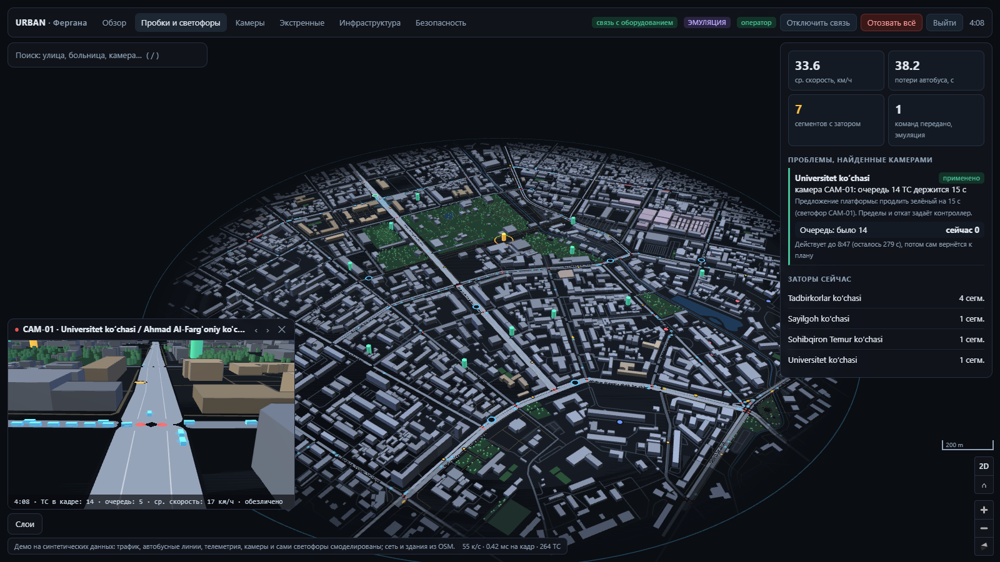
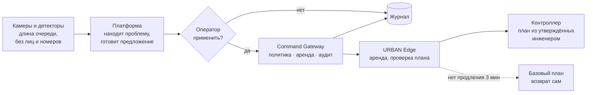
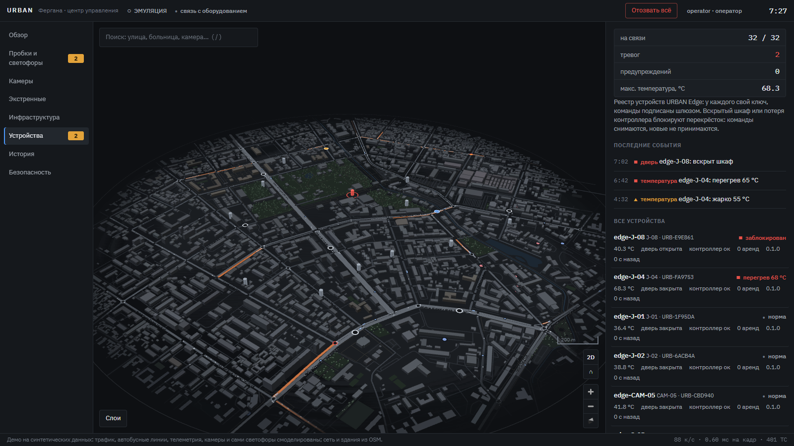
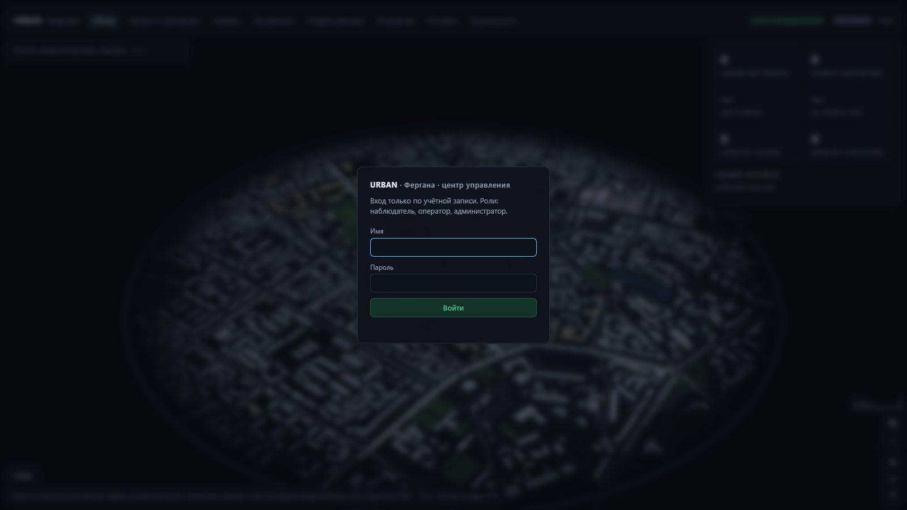

<div align="center">

# URBAN

**Центр управления городом, который защищает город, а не следит за жителями**

Камеры находят проблему · платформа предлагает решение · оператор решает · при сбое всё возвращается на место




</div>

## Что это

Демо-макет платформы **URBAN** (команда NEXUS) на цифровом двойнике центра Ферганы.
Работает локально на Windows, без Docker и без внешних сервисов.

Идея выросла из образа «городской операционной системы», но с обратным принципом:
**Protect the city, don't control its residents.** Камеры считают поток и очереди, а не людей;
платформа ничего не делает сама; любое вмешательство истекает само.

> **Важно:** оборудование в демо эмулируется. Реальные светофоры Ферганы не затрагиваются:
> они работают автономно, и для настоящего управления нужны модули связи на перекрёстках.

## Как это работает



1. **Датчик видит перекос.** На одном направлении в среднем за цикл стоит длинная очередь (от 40 м), а у поперечного зелёный простаивает.
2. **Платформа предлагает** один из планов, заранее утверждённых инженером для этого перекрёстка: +5, +10 или +15 секунд зелёного загруженному направлению за счёт свободного. Сама она ничего не применяет.
3. **Оператор решает.** Кнопки есть только у учётной записи с ролью оператора; наблюдатель видит всё, но не решает.
4. **Светофор помогает.** Цикл не удлиняется. Команда живёт как аренда и снимается сама, когда очередь ушла
   или начало страдать направление, отдающее зелёный.
5. **Сбой ничего не ломает.** Пропала связь или платформа — контроллер сам возвращает свой план.

| Камера нашла проблему | Реестр устройств и их здоровье |
|---|---|
|  |  |

| Журнал и правила безопасности | Вход по учётной записи |
|---|---|
|  |  |

## Почему это безопаснее

| Правило | Как сделано |
|---|---|
| Решает человек | платформа только предлагает; вход по учётной записи, роли наблюдатель / оператор / администратор, действия в журнале под именем |
| Один путь к оборудованию | Command Gateway с белым списком команд: сейчас разрешена одна |
| Только утверждённые планы | платформа не задаёт тайминги, а выбирает номер плана из таблицы перекрёстка; номер проверяют анализ, шлюз и само устройство |
| Команда истекает сама | аренда 3 минуты (два цикла), продление пока есть связь, окно подтверждения 15 минут |
| Откат на стороне оборудования | контроллер возвращает базовый план без участия платформы |
| Жёсткие пределы | в планах цикл не удлиняется, а минимальный зелёный учитывает время перехода пешеходов |
| Возврат без спроса | вернуть базовый план платформа может сама, в любой момент; усилить вмешательство — никогда |
| Отказ оператора действует | отклонённое предложение не возвращается, пока перекос на этом перекрёстке не исчезнет; «Отозвать всё» считается отказом для ожидающих |
| Аварийные кнопки | «Отозвать всё» и «Отключить связь» (показывает автооткат вживую) |
| Устройство не верит сети | каждая команда подписана шлюзом; устройство проверяет подпись, адрес, номер и свежесть и отказывает подделкам и повторам |
| Устройства под учётом | у каждого свой ключ в реестре; отозванное отключается сразу и больше не подключится |
| Всё записано | журнал аудита с цепочкой SHA-256, проверка целостности в `/api/audit` |
| Приватность | с камер уходят только счётчики; лица, номера и треки не обрабатываются |

Модель угроз и ступени допуска к управлению: [docs/security.md](docs/security.md).

## Помогает ли это на самом деле

Мы это измерили, а не предположили. Один и тот же трафик прогоняется дважды: без вмешательства и с
применением всех предложений платформы. По пять пар прогонов на каждую строку, 30 минут симуляции.

| Покрытие | Спрос | Потери времени на машину | Завершено поездок | Лучше в прогонах |
|---|---|---|---|---|
| датчики на всех 32 перекрёстках | средний (×0,75) | **−17,1 %** (194 → 161 с) | +5,6 % | 5 из 5 |
| датчики на всех 32 перекрёстках | высокий (×1,0) | **−12,0 %** (303 → 266 с) | +8,1 % | 5 из 5 |
| датчики на всех 32 перекрёстках | низкий (×0,5) | в пределах шума | в пределах шума | — |
| только 8 перекрёстков | средний (×0,75) | −3,0 % | в пределах шума | 5 из 5 |
| только 8 перекрёстков | высокий и низкий | в пределах шума | в пределах шума | — |

Что это значит:

- **Правило работает, если видеть весь район.** Платформа выбирает один из планов, утверждённых инженером;
  длина цикла не меняется; команда снимается сама, когда перестаёт помогать.
- **Восьми перекрёстков мало.** Если управлять только частью, задержка переезжает к соседним.
  Поэтому в демо очереди измеряются на всех 32 регулируемых перекрёстках, а окна камер есть у восьми.
- **Цифры получены в ограничениях реального оборудования:** очередь измеряется в метрах на 100 м подъезда,
  минимальный зелёный учитывает пешеходов, аренда длиннее цикла. Команд выходит около 19 за полчаса на район.
- **Первое правило не работало.** «Продлить зелёный подъезду с очередью» дало −0,1 % ± 1,7 %.
  Замер это показал, и правило было заменено; история версий в отчёте.

Оговорки важные: трафик синтетический, а исходные планы светофоров наивные (зелёный поровну), так что на
настроенных инженером перекрёстках выигрыш будет меньше. Полная таблица и ограничения:
[docs/benchmark.md](docs/benchmark.md).

## Быстрый старт

Нужны Python 3.11+ и Node.js 20+.

```powershell
scripts\setup.ps1     # один раз: окружение, зависимости, сборка интерфейса, подготовка данных
scripts\run.ps1       # запуск: http://localhost:8080; при первом запуске создаётся учётная запись admin,
                      # её пароль печатается в консоли (смените после входа);
                      # процесс URBAN Edge (32 устройства) стартует сам
```

<details>
<summary>То же самое вручную</summary>

```bash
python -m venv .venv
.venv/Scripts/python -m pip install -e "backend[dev]"
cd web && npm install && npm run build && cd ..
cp .env.example .env
.venv/Scripts/python -m urban.pipeline     # OSM -> сеть SUMO, спрос, слои карты
.venv/Scripts/python -m urban              # платформа; сама запускает процесс URBAN Edge
```

Тесты: `.venv/Scripts/python -m pytest backend`.
Замер эффекта: `.venv/Scripts/python -m urban.experiments.signal_rebalance` (60 прогонов, несколько минут).
Пересобрать только слои карты: `python -m urban.pipeline --geo`.
Перед запуском пайплайна остановите сервер: он держит файлы в `data/`.
Запустить устройства отдельно: `URBAN_EDGE=manual` для платформы и `python -m urban.edge` в другом окне.
Ключи и сертификаты демо создаются сами в `data/pki` (или командой `python -m urban.provision`).
Учётные записи: из интерфейса (администратор, кнопка «Учётные записи») или `python -m urban.users add <имя> --role operator`.

</details>

## Что есть в интерфейсе

| Модуль | Что показывает |
|---|---|
| **Обзор** | показатели района, проблемы, ждущие решения, лента анализа |
| **Пробки и светофоры** | перекосы на перекрёстках; «Применить» и «Отклонить»; оба направления до и после; отсчёт до возврата |
| **Камеры** | детекторы очередей на всех 32 регулируемых перекрёстках; у 8 есть окно камеры с видом, потоком и очередью |
| **Экстренные** | ДТП, выезд скорой и ДПС от реальных больниц и полиции, расчётное и фактическое время |
| **Инфраструктура** | 12 объектов (подстанции, насосные, теплопункты): отклонения и прогноз достижения порога |
| **Устройства** | реестр URBAN Edge: связь, температура, дверь шкафа, контроллер, версия; отзыв устройства |
| **История** | что пережило перезапуск: команды с решениями и итогами, запуски, целостность всей цепочки аудита (SQLite `data/urban.db`) |
| **Безопасность** | состояние связи, действующие правила, журнал аудита |

<details>
<summary>Управление картой</summary>

| Действие | Как |
|---|---|
| Перемещение | перетаскивание левой кнопкой, стрелки |
| Масштаб | колесо мыши (к курсору), двойной щелчок, кнопки и клавиши + и − |
| Поворот и наклон | правая кнопка или Ctrl + левая кнопка |
| Север вверх | щелчок по компасу |
| 2D / 3D, весь район | кнопки над масштабом |
| Поиск | поле слева вверху или клавиша `/`: улицы, больницы, полиция, камеры, объекты |
| Карточка объекта | щелчок по зданию, улице, остановке, объекту; Esc закрывает |
| Камеры | щелчок по камере; в окне перетаскивание меняет взгляд, стрелки переключают камеры |
| Слои | кнопка «Слои» слева внизу |
| Ссылка на вид | положение карты хранится в адресе страницы |

</details>

## Что настоящее, а что смоделировано

| Настоящее | Смоделировано |
|---|---|
| дорожная сеть, здания, больницы, полиция (OpenStreetMap) | трафик: случайные поездки в SUMO |
| шлюз команд: политика, аренда, решение оператора | светофоры и их контроллеры |
| логика URBAN Edge и адаптеры к контроллерам (реле, NTCIP) | измерение очереди: берётся истина симуляции, а не видео |
| отдельный процесс устройств, TLS, подписи команд, реестр и отзыв | сами устройства: 32 в одном процессе, ключи в файлах |
| журнал аудита, учётные записи и роли, блокировка перебора | камеры: вид двойника, не видеопоток |
| анализ очередей и отклонений | автобусные линии и остановки (в OSM по Фергане маршрутов нет) |
| | телеметрия объектов, высоты большинства зданий |

«ИИ» в макете — это понятные правила и статистика (устойчивая очередь, отклонение от базового уровня,
линейный тренд), а не обученные модели. Настоящая видеоаналитика должна работать на стороне камеры
и отдавать платформе только счётчики.

## Структура

```
backend/urban/
  core/          шина событий и контракты сообщений
  sources/       симуляция как источник данных, эмуляция датчиков очереди
  equipment/     логика аренды и адаптеры к контроллерам: SUMO, реле, NTCIP
  edge/          URBAN Edge как отдельный сервис: проверка подписи команд, отчёты
  devices/       реестр устройств, подписи, защищённый канал
  analytics/     очереди у камер, заторы, отклонения и прогноз
  gateway/       Command Gateway: политика, аренда, журнал аудита
  platform.py    ядро: анализ и предложения
  store.py       история в SQLite: цепочка аудита между запусками, команды, здоровье устройств, очереди
  api/           HTTP/WebSocket, вход и роли
  accounts.py    учётные записи, роли, сессии; users.py — консоль
  pipeline/      подготовка данных из OSM
  experiments/   замер эффекта управления
backend/tests/   75 тестов
web/src/         интерфейс: scene/ (3D-сцена), map/ (навигация, камера, поиск), ui/ (панель)
docs/            архитектура, безопасность, замер
```

Документы: [CONTEXT.md](CONTEXT.md) (замысел, решения, состояние) ·
[docs/architecture.md](docs/architecture.md) · [docs/hardware.md](docs/hardware.md) · [docs/software.md](docs/software.md) · [docs/security.md](docs/security.md) ·
[docs/benchmark.md](docs/benchmark.md)

## Что дальше

- Координация соседних перекрёстков («зелёная волна») и проверка тем же замером.
- Снизить нагрузку на оператора: группировка предложений по магистрали.
- Зелёный коридор для экстренных служб как вторая разрешённая команда.
- Реальные маршруты автобусов, хранилище событий, учётные записи операторов с ролями.
- Изучить контроллеры светофоров Ферганы и требования регулятора.

## Данные и инструменты

Картографические данные © участники [OpenStreetMap](https://www.openstreetmap.org/copyright), лицензия ODbL.
Симуляция: [Eclipse SUMO](https://eclipse.dev/sumo/). Отрисовка: [deck.gl](https://deck.gl) и [MapLibre](https://maplibre.org).
