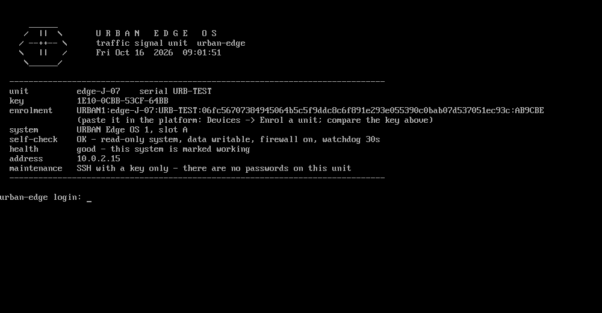

# URBAN OS (бывшая URBAN Edge OS)

Одна операционная система для всех трёх уровней URBAN: блока на перекрёстке, районного сервера и центра
управления. Это не «Linux, на который поставили программу», а прибор: система только для чтения, ключи и
настройки на отдельном разделе, обновления целиком и с подписью, откат без выезда. Роль машины задаётся при
установке, а мощность машина подбирает сама — по своей роли, нагрузке и температуре.

```
диск блока
├─ esp          загрузчик GRUB, состояние слотов (grubenv), urban-unit.txt — имя и роль машины
├─ rootfs-a     система, слот A  ─┐ только для чтения (squashfs); обновление пишется
├─ rootfs-b     система, слот B  ─┘ в слот, который сейчас не работает
└─ urban-data   ключ блока, комплект платформы, камеры, SSH, данные центра — то, что переживает обновления;
                при первой загрузке занимает весь оставшийся диск
```

## Три уровня и роли

```
  перекрёсток            район                       офис
  блок (unit)  ──────>  районный сервер (district) ──────>  центр (center)
               видео,                   только числа,
               команды                  команды
```

Подписывает команды только центр; районный сервер пересылает и разбирает камеры района, но подписать команду не
может. В пилоте районный сервер и центр — одна машина. Роль — строка `ROLE=` в `urban-unit.txt`:

| `ROLE=` | `UNIT=` | Что запускается при загрузке | Что открыто в файрволе |
|---|---|---|---|
| `unit` (по умолчанию) | `edge-<перекрёсток>` | ключ и код подключения; служба блока, когда поставлен комплект; камеры, если есть `cameras.json` | только SSH из частных сетей |
| `district` | `district-<имя>` | пересылка соединений блоков района в центр ядром (`CENTER=`); свой ключ и код подключения; отчёты центру очередями камер района (`cameras.json`) | SSH; 8443 из частных сетей пересылается в центр, сам сервер на нём не отвечает |
| `center` | `center` или `center-<имя>` | центр управления: интерфейс по HTTPS на 443, приём блоков на 8443 | 443 и 8443 из частных сетей |
| `district,center` | `center` | обе роли — пилот | 443 и 8443 из частных сетей |

При первой загрузке на диске больше образа раздел данных растягивается до конца диска — службой `urban-grow`,
до того как раздел смонтирован (если растягивать смонтированный, система на миг теряет раздел и отмонтирует его).

Для центра есть ещё `HOST=` — имя или адрес, по которому к нему приходят блоки и операторы; оно попадает в
сертификат центра. Для районного сервера — `CENTER=` (адрес центра, `host` или `host:port`), для блока —
`VISION=off` (лёгкий блок, см. ниже). Образ для конкретной машины делает
`node os/unit-image.mjs --role ... --unit ... --serial ...` ([mini-pc.md](mini-pc.md)).

## Районный сервер: ретранслятор и отчёты

Блок района подключается не к центру, а к районному серверу — так, будто это центр: в его комплекте `PLATFORM`
указывает на адрес районного сервера, а `SERVER_NAME` остаётся именем центра. Пересылает **ядро**: служба
`urban-relay` один раз ставит правило netfilter (DNAT порта 8443 из частных сетей на `CENTER=`) и дальше только
считает. Ни одна программа на районном сервере не держит байты блоков и не слушает порт 8443 — взламывать там
нечего, и это быстрее любой программы (нет копирования в пользовательское пространство). TLS-сессия остаётся
между блоком и центром: районный сервер видит только шифртекст, поэтому не может ни прочитать отчёт, ни
подделать команду — подписывает по-прежнему только центр, а центр по-прежнему проверяет каждый блок по его ключу.
Взломанный районный сервер может лишь перестать пересылать. Буфера у пересылки нет и быть не может (поток
зашифрован): при обрыве блок сам переподключается каждые две секунды, как и раньше.

Сам районный сервер — устройство центра. При первой загрузке он делает себе ключ и показывает код подключения
(`URBAN1:district-1:...`), как блок. Администратор в центре вставляет код и вводит **адрес, по которому к серверу
подключаются блоки** («Устройства → Подключить»), скачивает комплект и ставит его на сервер:
`urban-unit setup urban-district-1.json`. После этого служба `urban-district@district-1`
(`backend/urban/node/district.py`) раз в секунду отчитывается центру: очереди, которые меряют камеры района
(`/run/urban/queues.json`, по идентификаторам подходов), температура, что делает ретранслятор (сколько блоков
через него на связи). Команд районный сервер не выполняет — пришедшая команда отмечается в его отчёте как
отвергнутая и попадает в аудит центра.

Центр доверяет районному серверу **только числа и только за его перекрёстки**: очередь подхода принимается, если
блок этого перекрёстка подключён «через» этот район (так указано при подключении блока или командой
`python -m urban.provision assign edge-J-07 --district district-1`). Пока связи с центром нет, отчёты района
копятся (последние 15 минут) и после восстановления уходят по порядку, каждый со своим временем: центр кладёт их в
историю на то время, когда они были сделаны, не трогая текущие показания. В «Устройствах» район виден отдельной
строкой: адрес, сколько блоков через него, сколько отчётов ждут отправки.

Те же шаги без интерфейса (так делает проверка и демонстрация):

```bash
python -m urban.provision enroll-district district-1 --address 10.1.0.2 --public <ключ из кода>
python -m urban.provision enroll edge-J-07 --junction J-07 --public <ключ из кода>
python -m urban.provision assign edge-J-07 --district district-1
python -m urban.provision kit edge-J-07 > urban-edge-J-07.json      # комплект, как его отдаёт интерфейс
```

Для пилота (район и центр на одной машине, `ROLE=district,center`) ретранслятор не нужен и не запускается:
блоки подключаются прямо к центру; районная половина машины может отчитываться своими камерами, если её
подключить как район с адресом этой же машины.

## Лёгкий блок

`VISION=off` в `urban-unit.txt` — блок без распознавания: ни камер, ни модели, ни потоков под них. Образ тот же,
отличие только в том, что служба зрения не запускается никогда (даже если лежит `cameras.json`), план мощности
говорит `vision=off`, а экран — `junction unit, light (no cameras)`. Такой блок проверен в машине с 1 ГБ памяти:
занято меньше 400 МБ, служба блока работает и после перезагрузки. Это ответ для слабых мини-ПК и для
перекрёстков без камер; сборка под ARM — отдельный шаг, её пока нет.

## Шифрование раздела данных

На разделе данных лежит всё, что отличает одну машину от другой: ключ блока, комплект, ключи обслуживания, у
центра — база и ключи платформы. Если у машины есть TPM 2.0 (у современных мини-ПК это fTPM в BIOS), при первой
загрузке `urban-grow` превращает раздел в **LUKS2**, а ключ раздела запечатывает в TPM этой машины
(`systemd-cryptenroll --tpm2-device=auto`); одноразовая парольная фраза после этого стирается. Всё, что
установщик положил на раздел до этого (ключ обслуживания), переносится внутрь. Дальше раздел открывает
`systemd-cryptsetup` при каждой загрузке, без человека; монтируется он по метке файловой системы
(`LABEL=urban-data`), поэтому и открытый том, и обычный раздел попадают в `/var/lib/urban` одинаково.

Что это даёт: **диск, вынутый из машины, не читается** — ключа на нём нет, он в чипе. Ключ намеренно привязан к
самому чипу, а не к измерениям загрузки (PCR): обновление прошивки или системы не должно запереть блок от его
собственных данных; от украденного диска защищает уже сама привязка к чипу. Чего это не даёт: целая машина со
своим TPM загрузится и будет работать — для этого есть отзыв ключа в «Устройствах», как и раньше.

Без TPM раздел остаётся обычным; самопроверка пишет `data=rw,plain`, экран — `NOT encrypted - this machine has
no TPM`. Если TPM есть, а раздел не зашифрован, самопроверка не проходит. Проверка (`check-encrypted.mjs`)
смотрит на сырой раздел: на зашифрованном ключа обслуживания нет нигде, на обычном (контроль) он лежит открыто.

## Защита: что получит взломщик

Цель — чтобы взлом любой части давал как можно меньше, а по возможности ничего. Ниже — по уровням, что
получает тот, кто вошёл, и что ему мешает. Каждое «нет» проверяется в QEMU сценарием-«взломщиком»
(`check-hardened.mjs`): рядом с каждой пробой стоит контроль, который обязан сработать, — иначе сломанная проба
выдавала бы себя за защиту.

| Кто и где | Что получит | Почему так |
|---|---|---|
| Украл диск блока, района или центра | ничего | раздел данных — LUKS2, ключ в TPM той самой машины; на сыром диске ключа обслуживания нет (проверено) |
| Взломал службу блока (`urban-edge@`) | свой собственный ключ и сеть | «клетка» systemd: не видит ключей обслуживания, загрузочного раздела, чужих процессов; писать может только в папку своих ключей; нет ни одной привилегии, нет исполняемой памяти, нет лишних системных вызовов |
| Взломал службу зрения (`urban-vision@`) | кадры своих камер в памяти | не видит никаких ключей, пишет только `/run/urban`; кадры и так не сохраняются |
| Получил root на блоке | возможность выдавать себя за этот один блок, пока его не отзовут в «Устройствах» | ядро заперто (`lockdown=confidentiality`): нет `/dev/mem`, `/proc/kcore`, чужого кода в ядре; `ptrace` выключен для всех, даже для root — память службы с ключом не прочитать; нет дампов памяти; система только для чтения; подписать команду нельзя — подписывает только центр |
| Взломал районный сервер | шифртекст | пересылает ядро, программ, держащих байты блоков, нет; TLS — между блоком и центром; команду не подделать |
| Взломал центр | право выбирать утверждённые инженером планы на 3 минуты | так устроены блоки: только планы из паспорта перекрёстка, аренда с истечением, при пропаже связи — базовый план |
| Подслушал SSH | ничего | только ключи, только современная криптография: обмен ключами с постквантовой защитой (sntrup761 + X25519), AEAD-шифры; CBC, SHA-1 и малые группы Диффи-Хеллмана отвергаются (проверено) |

Остальное о защите: файрвол по умолчанию всё отбрасывает и открывает порты только роли; наружу на блоке
слушает только SSH (проверено); вход по SSH только с ключом; паролей в системе нет вообще.

Ядро настраивается двумя файлами: строкой загрузки (`os/build/grub.cfg`: `lockdown=confidentiality debugfs=off
vsyscall=none slab_nomerge page_alloc.shuffle=1 randomize_kstack_offset=on`) и
`os/rootfs/etc/sysctl.d/90-urban-hardening.conf` (`kernel.yama.ptrace_scope = 3`, `kptr_restrict`, без kexec, без
BPF для непривилегированных, без дампов памяти, сетевые ловушки отключены). «Клетки» служб — в их unit-файлах;
их оценку `systemd-analyze security` (0 — лучше всего, 10 — хуже) проверка требует не выше 3,0 для каждой
службы, которая смотрит в сеть.

Честные пределы (подробнее — «Что не проверено»): без Secure Boot root может переписать раздел системы на диске
(запись в чужой слот, а не установка пакета); ключ блока в памяти его службы — пока не в самом чипе, поэтому
root на работающем блоке может действовать от имени этого блока (но не читать его ключ напрямую и не командовать).

## Скорость

Задержки ищутся замером, а не на глаз. `python3 os/tests/vm.py measure <метка>` загружает блок в той же
виртуальной машине и записывает в `data/os/logs/measure-<метка>.json`: через сколько секунд после старта ядра
работает служба управления блока — с кабелем и с выдернутым кабелем; сколько процессорного времени съела
загрузка, по службам; сколько процессора занято, когда блок просто работает; сколько памяти. Проверка
`check-speed.mjs` сравнивает с замером предыдущего образа.

Что показал замер (эмуляция без KVM, всё примерно в 10 раз медленнее железа; важны пропорции) и что сделано:

| | До | После |
|---|---|---|
| служба управления блока работает, с кабелем | через 3,9 с после подготовки системы | 3,6 с |
| то же **без кабеля** | **через 40,2 с** — ждала сеть | **4,1 с** |
| процессорное время на загрузку | 31,6 с | 20,1 с (−36 %) |
| из них самопроверка | 9,9 с | 4,8 с |
| занято процессора в работе / памяти | 5,6 % / 259 МБ | 7,1 % / 264 МБ (в пределах шума замера) |

- **Ничто из URBAN не ждёт сети.** Службы блока, зрения, района и центра стартуют сразу и переподключаются сами;
  ожидание сети для остального — не дольше 10 с.
- **Самопроверка не загружает весь Python.** Модули она только находит; доказательство, что программа работает, —
  служба управления запущена и не перезапускается (у центра — его служба). Это и дешевле, и строже: сломанное
  обновление, при котором служба падает, откатывается.
- **Экран без интерпретатора:** менеджер мощности и пересылка пишут готовые строки, экран машины их только
  читает, а не запускает Python при каждой перерисовке.
- **Пересылка района в ядре** — без копирования байтов в программу и обратно.

Почему не переписали всё на другом языке: замер показал, что задержки не в языке. Путь команды на блоке
(проверка подписи Ed25519, выбор плана) занимает доли миллисекунды и на Python; время уходило на ожидание сети и
лишние процессы при загрузке. Ядро блока на Rust остаётся в плане перед серийным устройством — ради памяти и
надёжности, а не скорости.

## Демонстрация

Три машины в QEMU на этом компьютере — блок, районный сервер и центр, — каждая со своим экраном в браузере:

```bash
node os/demo.mjs          # поднять; напечатает адреса экранов и центра, коды подключения
node os/demo.mjs enrol    # подключить район и блок к центру командами центра (или руками в интерфейсе)
node os/demo.mjs kit urban-edge-J-01.json   # комплект, скачанный в интерфейсе, на его машину
node os/demo.mjs pilot    # одна машина: район и центр пилота
node os/demo.mjs stop     # выключить; каждый запуск — чистая установка
```

Экраны — `http://127.0.0.1:6080` (блок), `6081` (район), `6082` (центр); это noVNC (его исходники лежат в `os/demo/novnc`, лицензия MPL-2.0) перед VNC-дисплеями QEMU через `os/demo/screen.py`; центр управления —
`https://127.0.0.1:9443/` (его собственный сертификат: браузер предупредит один раз); пароль администратора — в
`data/os/logs/demo-admin.txt`. Адрес именно `127.0.0.1`, не `localhost`: на Windows `localhost` сначала пробует
IPv6 и теряет 200 мс на каждом новом соединении.

Без KVM (`/dev/kvm` в Docker) процессоры эмулируются и всё внутри примерно в 10 раз медленнее: загрузка трёх
машин занимает минуты. На Windows с процессором AMD вложенную виртуализацию для WSL2 блокирует «Целостность
памяти» (Безопасность Windows → Изоляция ядра); выключив её и добавив `nestedVirtualization=true` в
`%USERPROFILE%\.wslconfig`, получаете KVM после перезагрузки.

Экран пилотной машины (район и центр на одной), снимок из проверки в QEMU:


Центр на URBAN OS — это та же платформа, что ставится на сервер по `deploy/`, только без nginx: интерфейс
отдаётся по HTTPS с сертификатом самого центра, данные (город, ключи, учётные записи, история) лежат в
`/var/lib/urban/platform`, настройки — в `/var/lib/urban/etc/platform.env`. Пароль первого администратора
печатается один раз в журнал: `journalctl -u urban-platform`. Город загружается командой
`python -m urban.city create` (нужен выход в интернет к OpenStreetMap; центру он открыт на порт 443).

## Мощность

Служба `urban-power` (`backend/urban/node/power.py`) каждые 5 секунд смотрит на температуру процессора, его
загрузку и работу камер (сколько камер и сколько миллисекунд занимает кадр) и решает:

| | Блок на перекрёстке | Районный сервер и центр |
|---|---|---|
| до 70 °C / до 80 °C | всё как задумано: 4 кадра в секунду на камеру | полная работа |
| 70–80 °C / 80–90 °C | вдвое меньше кадров, частота до 80 % | полная работа, но без режима «максимум скорости» |
| 80–90 °C / 90–98 °C | четверть кадров, частота до 60 % | половина кадров, частота до 80 % |
| выше 90 °C / выше 98 °C | распознавание на паузе, частота до 50 % | четверть кадров, частота до 60 % |
| потоков распознавания | не больше двух | все ядра, кроме оставленных (центру — два под платформу) |

- **Связь блока с контроллером и платформой не трогается никогда**: она лёгкая и должна работать всегда. Пока
  распознавание на паузе, подходы показывают «нет данных» — это правда.
- **По нагрузке:** если камер больше, чем успевает детектор, кадров становится меньше (до 80 % его
  возможностей), а не копится очередь кадров. Загруженный сервер просит процессор работать быстрее
  (`energy_performance_preference`), простаивающий — экономить.
- **Без дёрганья:** уровень поднимается сразу, а опускается, только когда стало на 5 °C холоднее порога.
- План лежит в `/run/urban/power.json`; распознавание читает его на лету, экран машины показывает его строкой
  `power`. Нет датчика температуры (бывает в виртуальных машинах) — машина считает себя холодной и пишет об этом.

## Что внутри

- **Debian 12 (bookworm)**, ядро Debian, systemd. Только нужное: сеть, время, SSH, файрвол, RAUC, Python.
- **Программа URBAN** — `urban.edge` (связь с платформой и контроллером) и `urban.vision` (камеры, YOLOX),
  с моделью `yolox_nano.onnx`, если она была в `data/models/` при сборке.
- **Корень только для чтения.** Система — образ squashfs: её нельзя изменить ни случайно, ни намеренно. Пишется
  только раздел данных и память (`/tmp`, журналы).
- **Файрвол по умолчанию закрыт.** Входящие — только SSH из частных сетей (шкаф, VPN службы). Исходящие — сеть
  шкафа (камеры, контроллер), платформа на порту 8443, DNS и время. Остальное отбрасывается.
- **Вход только по ключу SSH.** Паролей нет ни у кого, в том числе у root. Ключи обслуживания — в
  `/var/lib/urban/ssh/authorized_keys` на разделе данных.
- **Сторожевой таймер.** Зависшая система перезапускается за полминуты.
- **Самопроверка при каждой загрузке** (`urban-os-check`): корень только для чтения, раздел данных, файрвол,
  таймер, SSH без паролей, программа URBAN запускается. Итог — одна строка `URBAN-OS-CHECK OK …` на экране и в
  последовательной консоли.

## Сборка

Нужен запущенный Docker — только как среда сборки (Debian внутри контейнера); в самой ОС Docker нет.

```bash
node os/build.mjs --export                    # версия 1: образ диска и пакет обновления, выгрузить для записи
node os/build.mjs --version 2 --bundle-only   # следующая версия: только пакет обновления
```

Сборка живёт в томе Docker `urban-os` (кэш Debian, образы систем, диски): там пустые блоки не занимают места.
На диск компьютера попадает только нужное:

| Файл | Что это |
|---|---|
| `data/os/release/urban-edge-1.img.gz` | образ диска для новой коробки, сжатый (внутри 5,2 ГБ, слот B пуст) — после `--export` |
| `data/os/release/urban-edge-1.raucb` | подписанный пакет обновления той же системы |
| `data/os/release/manifest-1.json` | версия и SHA-256 всех файлов выпуска |
| `data/os/keys/ca.pem`, `ca.key` | удостоверяющий центр обновлений: `ca.pem` зашит в систему, `ca.key` — в сейф |
| `data/os/keys/signing.pem`, `signing.key` | ключ подписи выпусков |
| `data/os/logs/` | последовательные консоли виртуальных машин из проверок |

Первая сборка скачивает Debian и пакеты Python (OpenCV, ONNX Runtime), это около получаса; следующие используют
кэш и занимают несколько минут. Ключи создаются при первой сборке (`os/build/keys.sh`) и **действуют с 1 января
2020 года**, какое бы время ни показывали часы машины сборки: у блока в шкафу часы могут сбиться (нет батарейки,
ещё нет сети), и сертификат «из будущего» заставил бы его отвергать все обновления. Так однажды и случилось при
проверке — часы компьютера сборки спешили на 12 часов. **Кто владеет `keys/signing.key`, тот может выпустить
обновление для всех блоков города** — на рабочей машине разработчика держать его можно только для пилота; для
серийных блоков подпись выносится на отдельный компьютер без сети или в аппаратный модуль.

## Запись образа на блок

1. Записать `urban-edge-1.img.gz` на диск блока (SSD/eMMC) — balenaEtcher принимает сжатый образ как есть; на
   Linux `gunzip -c urban-edge-1.img.gz | dd of=/dev/sdX bs=4M conv=fsync`.
2. Подключить записанный диск к ноутбуку: появится маленький раздел **URBAN-ESP**. В нём файл `urban-unit.txt`:
   ```
   UNIT=edge-J-07
   SERIAL=URB-0042
   ```
   `UNIT` — блок перекрёстка (`edge-` и номер перекрёстка из платформы), `SERIAL` — номер с наклейки на коробке.
3. Положить ключ обслуживания: файл `maintenance.pub` на том же разделе URBAN-ESP (открытые ключи SSH, по одному
   в строке). При загрузке блок проверяет каждый ключ, переносит его в `ssh/authorized_keys` на разделе данных и
   переименовывает файл в `maintenance.pub.imported`. Войти с консоли нельзя: паролей нет. Шаги 2 и 3 за вас
   делает `node os/unit-image.mjs --unit edge-J-07 --serial URB-0042` — см. [mini-pc.md](mini-pc.md).

Поставить на настоящий мини-ПК — пошагово, с BIOS и чек-листом стенда: [mini-pc.md](mini-pc.md).

## Первая загрузка

При первой загрузке с указанным `UNIT` блок сам создаёт свой ключ. Ключ никогда не покидает раздел данных. В
последовательную консоль выводится строка:

```
URBAN-ENROLMENT unit=edge-J-07 serial=URB-0042 fingerprint=A8F1-1E80-B585-C32C code=URBAN1:edge-J-07:…
```

### Экран блока

У блока нет рабочего стола — это прибор. Его «лицо» — экран, который виден, если подключить монитор: монтажнику
ничего не нужно набирать. Так он выглядит (снимок из проверки в QEMU, `vm.py screen`):



То же текстом:

```
      ______
     /  ||  \       U R B A N   E D G E   O S
    / --++-- \      traffic signal unit  urban-edge
    \   ||   /      Fri Oct 16  2026  09:01:51
     \______/

  ------------------------------------------------------------------------------
  unit          edge-J-07    serial URB-TEST
  key           1E10-0CBB-53CF-64BB
  enrolment     URBAN1:edge-J-07:URB-TEST:06fc…:AB9CBE
                (paste it in the platform: Devices -> Enrol a unit; compare the key above)
  system        URBAN Edge OS 1, slot A
  self-check    OK - read-only system, data writable, firewall on, watchdog 30s
  health        good - this system is marked working
  address       10.0.2.15
  maintenance   SSH with a key only - there are no passwords on this unit
  ------------------------------------------------------------------------------

urban-edge login:
```

Экран собирает `urban-console`. Его вызывают службы загрузки (`urban-prepare`, `urban-os-check`, `urban-health`),
и он обновляется по мере загрузки: сначала «running», потом итог самопроверки, потом решение о слоте. Если
самопроверка не прошла, на экране причина («FAILED - …»), а в строке health — «BAD» (откат на прошлую систему)
или «DEGRADED» (вызвать обслуживание). Если блоку не задано имя, экран говорит, что вписать в `urban-unit.txt`.
Корень системы только для чтения, поэтому живая часть лежит в `/run/urban/console.issue`, а
`/etc/issue.d/50-urban.issue` — ссылка на неё. Адрес подставляет сам getty, он всегда текущий.

Дальше как в «Устройства → Подключить блок»: администратор вставляет код, сверяет отпечаток, скачивает комплект.
На блоке, по SSH:

```bash
urban-unit setup urban-edge-J-07.json    # комплект платформы; служба блока запускается сама
nano /etc/urban/edge-edge-J-07.env       # связь с контроллером: ADAPTER, CONTROLLER, датчики шкафа
systemctl restart urban-edge@edge-J-07
urban-unit status                        # кто я, мой ключ, версия, слот, службы
```

Без `UNIT` блок загружается, но ключа не создаёт и пишет `URBAN-ENROLMENT none` с объяснением, что сделать.
Повторные загрузки ключ не меняют. Новый ключ — только новая установка (замена коробки в «Подключить блок»).

## Обновления

```bash
node os/build.mjs --version 2 --bundle-only --export   # на машине сборки: пакет в data/os/release/
scp data/os/release/urban-edge-2.raucb root@<блок>:/var/lib/urban/update/
urban-unit update /var/lib/urban/update/urban-edge-2.raucb   # на блоке
```

`urban-unit update` проверяет подпись пакета ключом URBAN, зашитым в систему, пишет новую систему в свободный слот
и перезагружает блок в неё. Пакет с чужой подписью или для другого устройства не ставится, текущие слоты не
трогаются. Ключ блока, комплект и настройки камер на разделе данных обновлением не затрагиваются.

## Откат

Загрузчик выбирает слот по состоянию в `grubenv`. Новая система загружается с отметкой «пробуется». После загрузки
служба `urban-health` смотрит на самопроверку:

- **самопроверка прошла** — слот отмечается рабочим;
- **не прошла** — слот отмечается плохим, блок перезагружается и загрузчик сам возвращает предыдущую систему;
- **система зависла или ядро упало** — сторожевой таймер перезапускает блок, слот «пробуется» не выбирается второй
  раз — тоже возврат к предыдущей.

Выезжать к шкафу не нужно ни в одном из трёх случаев. Если плохи обе системы, блок останавливается с сообщением на
экране — тогда перепрошивка.

## Проверка

Каждое обещание этого документа проверяется в QEMU на настоящем образе (`GATES.md`, unlazy):

```bash
node os/tests/check-image.mjs          # разметка диска, squashfs в слоте A, подпись пакета
node os/tests/check-boot.mjs           # загрузка, корень только для чтения, файрвол, таймер, SSH без паролей
node os/tests/check-firstboot.mjs      # ключ и код при первой загрузке, тот же ключ после перезагрузки
node os/tests/check-update.mjs good    # обновление 1 → 2 в слот B
node os/tests/check-update.mjs foreign # пакет с чужой подписью не ставится
node os/tests/check-update.mjs broken  # сломанная версия 3 откатывается на 1 сама
node os/tests/check-roles.mjs          # районный сервер и центр на большом диске: раздел растёт, HTTPS, порты
node os/tests/check-hardware.mjs       # загрузка с NVMe, SATA и USB с сетевой картой Intel
node os/tests/check-unit-image.mjs     # образ блока: ключ с ESP, комплект, служба после перезагрузки
node os/tests/check-encrypted.mjs      # с TPM раздел данных — LUKS2 с ключом в TPM; без TPM — обычный, и экран говорит
node os/tests/check-light.mjs          # лёгкий блок (VISION=off) в 1 ГБ памяти, без процесса зрения
node os/tests/check-chain.mjs          # блок → район → центр: ретранслятор, район как устройство, буфер на время обрыва
node os/demo.mjs smoke                 # демонстрация поднимается и выключается одной командой
```

## Что не проверено

- **Не проверено на настоящем железе.** Всё выше — виртуальная машина QEMU (x86_64, UEFI, сторожевой таймер
  i6300esb). Нужна проверка на выбранном вычислителе: его сторожевой таймер, сетевые карты, нагрев.
- **Только x86_64.** Сборка для ARM (Raspberry Pi, Jetson) — отдельная работа: другой загрузчик и ядро.
- **Ключ блока не в самом чипе.** Он лежит в зашифрованном разделе и в памяти службы; root на работающем блоке
  может действовать от имени этого блока (отзывается в «Устройствах»). Следующий шаг — подпись внутри TPM.
- **Защищённая загрузка (Secure Boot) не включена.** Раздел данных зашифрован ключом в TPM (выше), но сам
  загрузчик и система не подписаны: подменить систему на диске пока можно. Следующий шаг — Secure Boot и привязка
  ключа к измерениям загрузки, когда обновления научатся не ломать её.
- **TPM на настоящем железе.** Шифрование проверено только с программным TPM (swtpm) в QEMU; fTPM мини-ПК
  нужно включить в BIOS и проверить.
- **Доставка обновлений с платформы не сделана**: пакет кладётся на блок по SSH. Платформа пока не раздаёт
  обновления сама.
- **Мощность на настоящем железе.** Решения проверены тестами на подставных датчиках и файлах cpufreq; в QEMU
  нет ни датчика температуры, ни управления частотой. Как ведёт себя блок в жарком шкафу — испытание Д.
- **Канала WireGuard между перекрёстком и районом нет.** Соединение блока защищено сквозным TLS до центра, но
  сеть между перекрёстком и районным шкафом (камеры, обслуживание) пока не закрыта туннелем — следующий шаг.
- **Сборки под ARM нет.** Лёгкий блок — тот же образ x86-64 с выключенным зрением; Raspberry Pi и подобные —
  отдельная работа (другой загрузчик и ядро).
